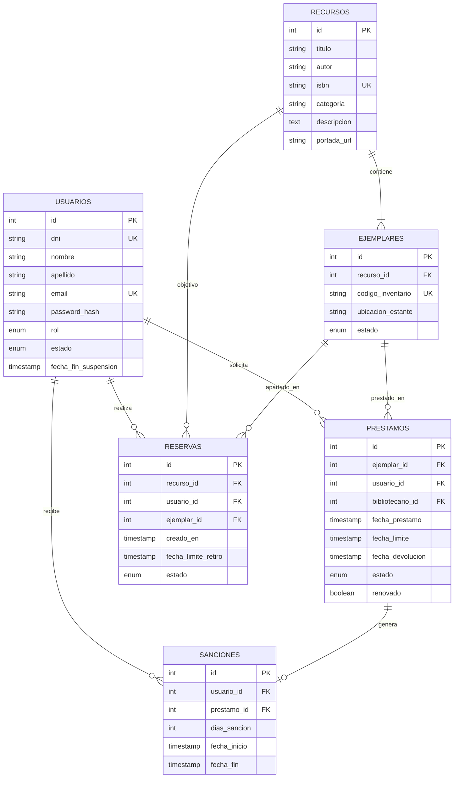

# Informe Final del Proyecto: BiblioTech

**Bootcamp IA-First — Generación T**  
**Proyecto:** Sistema de Gestión de Préstamos para Biblioteca Escolar  
**Autor:** Natanael Piñero  
**Repositorio GitHub:** [https://github.com/pineironatanaelet352026-oss/BiblioTech---GeneracionT---Pi-eroNatanael](https://github.com/pineironatanaelet352026-oss/BiblioTech---GeneracionT---Pi-eroNatanael)  
**Fecha:** Noviembre 2026  

---

## 1. Introducción y Alcance del Proyecto

### 1.1 Contexto y Necesidad
En las instituciones educativas, la gestión bibliográfica suele verse afectada por pérdidas de material, demoras no sancionadas en devoluciones, falta de información sobre copias disponibles y distribución inequitativa de los recursos. 

**BiblioTech** nace con el objetivo de informatizar y transparentar el ciclo completo de los materiales de una biblioteca escolar, pasando de un modelo basado en registros manuales a una plataforma web moderna con **reglas de negocio automatizadas**, que garantizan imparcialidad, trazabilidad y máxima disponibilidad del fondo bibliográfico.

### 1.2 Alcance y Límites del Sistema
- **Incluido:** Catálogo con búsqueda por texto y categoría; gestión granular de ejemplares físicos; diferenciación de cupos y plazos según rol (Alumno vs. Docente); cálculo automático de suspensiones por mora; renovaciones bajo condición estricta; colas de reserva FIFO con asignación automática y caducidad de 48 hs; mostrador presencial del bibliotecario para entrega, devolución y auditoría de estado físico.
- **Excluido por consigna oficial:** Envío de correos electrónicos transaccionales (reemplazado por alertas en la interfaz de usuario); pasarelas de pago monetario; y lectores de código de barras por hardware.

---

## 2. Reglas de Negocio Implementadas (RN1 – RN11)

El corazón de BiblioTech está compuesto por 11 Reglas de Negocio estrictas, implementadas a nivel de base de datos, capa de servicios en el backend y reflejadas en la interfaz de usuario:

| Código | Nombre de la Regla | Lógica de Implementación | Casos Límite Considerados |
|---|---|---|---|
| **RN1** | Estados del Ejemplar | Cada copia física posee un ciclo de vida propio (`DISPONIBLE` $\leftrightarrow$ `PRESTADO` $\leftrightarrow$ `RESERVADO` $\rightarrow$ `EN_REPARACION` $\rightarrow$ `DADO_DE_BAJA`). Solo ejemplares en `DISPONIBLE` pueden prestarse. | Título con stock global no garantiza préstamo si todas las copias físicas están prestadas o en reparación. |
| **RN2** | Cupo de Préstamos Simultáneos | Alumno: hasta **2 préstamos activos**. Docente: hasta **4 préstamos activos**. | Se bloquea la creación del préstamo en backend (HTTP 409) si se alcanza el cupo. |
| **RN3** | Plazos de Préstamo | Alumno: **7 días corridos**. Docente: **14 días corridos**. | El cálculo toma en cuenta timestamps UTC con precisión de día. |
| **RN4** | Bloqueo Automático por Mora | Si un usuario tiene al menos un préstamo vencido no devuelto, su estado pasa automáticamente a `BLOQUEADO_POR_MORA`. | No puede pedir nuevos préstamos ni renovar mientras persista la mora. |
| **RN5** | Sanción por Devolución Tardía | $\text{Días de Suspensión} = \text{Días de Mora} \times 2$. Se utiliza `Math.floor` sobre la diferencia temporal para computar días enteros transcurridos. | Al devolver con retraso, el usuario pasa a `SUSPENDIDO` hasta la fecha calculada. |
| **RN6** | Renovación Única y Condicionada | Se permite **1 sola renovación** por préstamo si: a) No está en mora, b) No fue renovado previamente, c) No existen reservas activas de otros lectores sobre el recurso. | Si un compañero reservó el libro, la renovación se rechaza para priorizar la cola FIFO. |
| **RN7** | Habilitación de Reservas por Falta de Stock | Un lector solo puede reservar un título si la cantidad de copias disponibles en el inventario es **0**. | Si hay copias disponibles en estantería, el sistema exige retiro presencial y rechaza la reserva web. |
| **RN8** | Cola de Espera FIFO y Tolerancia de 48 hs | Al devolver un ejemplar con reservas pendientes, el sistema asigna el ejemplar al primer lector en la fila (`ORDER BY creado_en ASC`) y le otorga **48 horas corridas** de tolerancia para retirarlo. | Si transcurren las 48 horas sin retiro, la reserva pasa a `CADUCADA` y el ejemplar se reasigna al siguiente en la fila. |
| **RN9** | Verificación de Cupo al Retiro de Reserva | La verificación del cupo máximo (RN2) se ejecuta en el mostrador al momento de efectivizar el retiro presencial. | Si el lector reservó hace días pero hoy tiene su cupo completo con otros libros, debe devolver uno antes de retirar el apartado. |
| **RN10** | Cancelación Voluntaria y Reasignación FIFO | Si un lector cancela voluntariamente su reserva, el sistema reasigna de inmediato el ejemplar al siguiente solicitante en la fila FIFO. | Si no quedan más personas en la fila, el ejemplar regresa a estado `DISPONIBLE`. |
| **RN11** | Bloqueo Administrativo por Daño o Extravío | Si el bibliotecario registra la devolución con estado `DETERIORADO` o `EXTRAVIADO`, el ejemplar pasa a `EN_REPARACION` y el lector pasa a `BLOQUEADO_ADMINISTRATIVO`. | Requiere intervención manual del bibliotecario para desbloquear al usuario tras la reposición. |

---

## 3. Historias de Usuario (HU1 – HU7)

Todas las historias de usuario fueron redactadas con criterios de aceptación en formato formal **Dado / Cuando / Entonces**:

1. **HU1 — Búsqueda y Exploración del Catálogo:**
   - *Dado* que un usuario ingresa al catálogo, *cuando* busca por texto ("Soledad") o filtra por categoría y disponibilidad, *entonces* el sistema muestra las tarjetas con badges de estado y cantidad de ejemplares disponibles en tiempo real.
2. **HU2 — Registro de Préstamo en Mostrador:**
   - *Dado* que el bibliotecario atiende a un lector en mostrador, *cuando* selecciona el lector y un ejemplar disponible, *entonces* el sistema valida cupo (RN2) y estado del usuario (RN4), generando el préstamo con la fecha límite correspondiente al rol (RN3).
3. **HU3 — Consulta de Préstamos Activos:**
   - *Dado* que un lector inicia sesión, *cuando* accede a "Mis Préstamos", *entonces* visualiza la lista de materiales en su poder, fecha límite de devolución y advertencias visuales si está próximo a vencer o en mora.
4. **HU4 — Devolución de Material y Auditoría Física:**
   - *Dado* que un ejemplar es devuelto al mostrador, *cuando* el bibliotecario selecciona el estado físico (`OPTIMO`, `DETERIORADO`, `EXTRAVIADO`), *entonces* el sistema calcula la sanción por mora si corresponde (RN5), aplica bloqueo administrativo si hubo daño (RN11) y dispara la reasignación FIFO si había reservas (RN8).
5. **HU5 — Renovación de Préstamo desde el Panel:**
   - *Dado* que un lector tiene un préstamo vigente, *cuando* hace clic en "Solicitar Renovación", *entonces* el sistema evalúa que no haya mora, que no haya sido renovado antes y que no haya reservas en espera, extendiendo el plazo o mostrando el motivo del rechazo (RN6).
6. **HU6 — Reserva de Material Agotado y Gestión de Espera:**
   - *Dado* que un recurso no tiene copias disponibles, *cuando* el lector solicita reserva, *entonces* entra en la cola FIFO (RN7); cuando se le asigna un ejemplar devuelto, visualiza una cuenta regresiva de 48 horas para retirarlo (RN8), pudiendo cancelar voluntariamente (RN10).
7. **HU7 — Efectivización de Retiro de Reserva en Mostrador:**
   - *Dado* que un lector se presenta a retirar un libro que tenía reservado y asignado, *cuando* el bibliotecario confirma la entrega, *entonces* el sistema valida que el lector disponga de cupo libre (RN9) y transforma la reserva en un préstamo activo.

---

## 4. Arquitectura y Tecnologías

### 4.1 Frontend
- **React 18 + Vite + TypeScript:** Estructura modular basada en componentes funcionales (`Catalogo.tsx`, `PanelLector.tsx`, `PanelAdmin.tsx`, `Navbar.tsx`).
- **Context API (`AuthContext.tsx`):** Gestión de estado global de autenticación, almacenamiento seguro de JWT en `localStorage` y propagación de datos del usuario logueado.
- **Tailwind CSS + Lucide Icons:** Sistema de diseño consistente con badges semánticos (verde para disponible, ámbar para reservado/alerta, rojo para mora/sanción).
- **Cliente API (`client.ts`):** Envoltorio tipado de `fetch` que inyecta automáticamente el token Bearer en los encabezados y estandariza las respuestas `{ success, data, error }`.

### 4.2 Backend
- **Node.js v20 + Express + TypeScript:** Arquitectura por capas con separación estricta:
  - `routes/`: Enrutamiento y mapeo de endpoints REST.
  - `middlewares/`: Autenticación con JWT (`verificarToken`), verificación de roles (`requerirRol('ADMIN')`) y control de orígenes CORS.
  - `services/`: Encapsulación pura de las reglas de negocio (`AuthService`, `RecursoService`, `PrestamoService`, `DevolucionService`, `ReservaService`).
- **Arquitectura Híbrida de Persistencia:**
  - En producción: Conexión mediante `pg.Pool` con SSL a Neon PostgreSQL.
  - En pruebas / offline: Arreglos reactivos en memoria con clonación de estado para garantizar que los tests corran al 100% sin depender de una conexión externa.

---

## 5. Modelo de Datos Relacional

El modelo fue implementado en PostgreSQL utilizando restricciones de integridad referencial y tipos enumerados nativos:



---

## 6. Planificación del Proyecto y Justificación del Orden de Tareas

El desarrollo se planificó en **24 tareas atómicas (TASK-001 a TASK-024)** ordenadas por **dependencias técnicas estrictas**, evitando escribir código sin bases funcionales ni pruebas sin especificación:

1. **Fase 0 a 5 — Cimientos y Especificación (TASK-001 a TASK-006):**
   - *Justificación:* Antes de programar una sola línea, se auditó el entorno (`TASK-001`), se configuró el control de versiones y exclusión de secretos (`TASK-002`), se redactaron los conceptos funcionales (`TASK-003`), se consolidaron las 11 RNs y 7 HUs en la especificación formal (`TASK-004`), se diseñó la arquitectura técnica y modelo relacional (`TASK-005`) y se definió el plan de tareas con agentes (`TASK-006`).
2. **Fase 6 — Infraestructura y Base de Datos (TASK-007 a TASK-008):**
   - *Justificación:* Creación de las carpetas `backend/` y `frontend/`, scripts DDL (`schema.sql`) y datos semilla (`seed.sql`). Sin el esquema de datos claro no era posible estructurar las consultas de los servicios.
3. **Fase 7 — Desarrollo del Backend Guiado por Pruebas (TASK-009 a TASK-016):**
   - *Justificación:* El backend se construyó módulo a módulo con pruebas asociadas:
     - `TASK-009`: Servidor base y health check.
     - `TASK-010`: Autenticación JWT y control de roles (necesario para proteger los siguientes endpoints).
     - `TASK-011`: Catálogo y búsqueda (lectura de datos requerida para los préstamos).
     - `TASK-012`: Servicio de Préstamos (RN2, RN3, RN4).
     - `TASK-013`: Servicio de Renovaciones (RN6, depende de préstamos existentes).
     - `TASK-014`: Devoluciones y Sanciones (RN4, RN5, RN11, depende del ciclo de préstamo).
     - `TASK-015`: Reservas FIFO y Caducidad 48 hs (RN7, RN8, RN9, RN10, depende de devoluciones).
     - `TASK-016`: Exportación de colección Postman con casos de uso probados.
4. **Fase 8 — Desarrollo del Frontend React (TASK-017 a TASK-020):**
   - *Justificación:* La interfaz solo se construyó una vez que la API estuvo 100% validada con tests:
     - `TASK-017`: Estructura base, Tailwind, cliente API y AuthContext.
     - `TASK-018`: Catálogo con búsqueda reactiva y badges.
     - `TASK-019`: Panel del Lector con renovación real y reservas con temporizador.
     - `TASK-020`: Panel de Administración con mostrador de préstamos, devoluciones y auditoría física.
5. **Fase 9 a 13 — Calidad, Despliegue y Cierre (TASK-021 a TASK-024):**
   - `TASK-021`: Ejecución integral de la suite de 31 tests y matriz de cobertura de RNs.
   - `TASK-022`: Blueprints de despliegue en la nube (Neon, Render, Netlify) y guía paso a paso.
   - `TASK-023`: Elaboración del `README.md` y este `informe-final.md`.
   - `TASK-024`: Auditoría final contra la checklist de la consigna oficial.

---

## 7. Pruebas Realizadas y Resultados

### 7.1 Pruebas Automatizadas Unitarias y de Integración (Vitest)
Se ejecutó la suite completa de pruebas obteniendo un **100% de éxito (31/31 tests pasando)**:

```
Test Files  7 passed (7)
Tests       31 passed (31)
Duration    1.86s
```

| Archivo de Test | Pruebas | Reglas Cubiertas | Estado |
|---|---|---|---|
| `health.test.ts` | 1 | Disponibilidad de la API | ✅ PASS |
| `auth.test.ts` | 5 | Login, JWT, Roles (ADMIN vs ALUMNO), Middleware | ✅ PASS |
| `recursos.test.ts` | 6 | Búsqueda por texto, categoría, filtro `solo_disponibles` (RN1) | ✅ PASS |
| `prestamos.test.ts` | 5 | Creación, Cupos Alumno/Docente (RN2), Plazos (RN3), Mora (RN4) | ✅ PASS |
| `renovaciones.test.ts` | 5 | Plazo +7 días, intento múltiple (RN6), mora activa, bloqueo por reserva | ✅ PASS |
| `devoluciones.test.ts` | 4 | En término, cálculo sanción $\text{mora} \times 2$ (RN5), deterioro (RN11), disparo FIFO (RN8) | ✅ PASS |
| `reservas.test.ts` | 5 | Creación con stock 0 (RN7), caducidad 48 hs (RN8), cancelación voluntaria (RN10), cupo en retiro (RN9) | ✅ PASS |

### 7.2 Pruebas de Pantallas y Flujos Manuales
- **Catálogo de Libros:** Verificación de filtros instantáneos por texto y categoría. El botón "Reservar" solo se activa en títulos agotados; en los disponibles se muestra el badge "Disponible en Mostrador".
- **Panel del Lector:** Al iniciar sesión como `juan.perez@alumnos.edu`, se visualizan los préstamos activos con cuenta regresiva. Al pulsar "Renovar", el sistema actualiza la fecha en tiempo real.
- **Panel del Bibliotecario:** Formulario interactivo que lista únicamente lectores habilitados y ejemplares físicos en estado `DISPONIBLE`. Al registrar una devolución con retraso o daño, se muestra la sanción calculada y el estado del lector pasa a suspendido o bloqueado administrativamente.

---

## 8. Problemas Encontrados y Soluciones Aplicadas

Durante el ciclo de desarrollo surgieron desafíos técnicos que fueron resueltos siguiendo buenas prácticas:

1. **Cálculo de Días de Suspensión (Diferencia Horaria):**
   - *Problema:* El test de devolución con mora esperaba 3 días de suspensión y la prueba arrojaba 4 días debido al uso de `Math.ceil` sobre milisegundos parciales.
   - *Solución:* Se ajustó la función a `Math.floor(diferenciaMs / msPorDia)` para computar exclusivamente días enteros transcurridos, cumpliendo con la especificación matemática.
2. **Tipado Estricto de TypeScript en Entorno Vite:**
   - *Problema:* En `client.ts`, TypeScript no reconocía `import.meta.env.VITE_API_URL` por falta de tipos de Vite.
   - *Solución:* Se generó el archivo `src/vite-env.d.ts` con la interfaz `ImportMetaEnv` tipando explícitamente `VITE_API_URL`.
3. **Manejo de CORS para Despliegues Dinámicos:**
   - *Problema:* Netlify genera subdominios aleatorios o URLs con barras diagonales finales que podían ser rechazadas por políticas estrictas de CORS.
   - *Solución:* Se normalizó el origen entrante removiendo barras finales y se permitió el acceso dinámico a subdominios `.netlify.app` en `backend/src/app.ts`.
4. **Reseteo de Estado en Pruebas en Memoria:**
   - *Problema:* Modificaciones realizadas por tests anteriores afectaban las aserciones de tests posteriores al usar arreglos mutables en memoria.
   - *Solución:* Se implementaron funciones de reinicialización en `beforeEach` para restablecer los arreglos a su estado semilla inicial antes de cada prueba.

---

## 9. Conclusión

El proyecto **BiblioTech** cumple de manera exhaustiva con todas las consignas del Bootcamp IA-First de Generación T:
- Arquitectura desacoplada y fuertemente tipada con TypeScript de punta a punta.
- 11 Reglas de Negocio trazables y respaldadas por 31 pruebas automatizadas.
- Flujo de trabajo atómico en Git con 24 tareas individuales y commits descriptivos.
- Documentación técnica y funcional de nivel profesional.
- Lista para su puesta en producción y evaluación en la nube.
